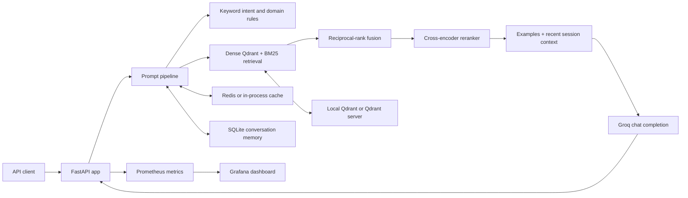

# PromptBridge system architecture

**Status:** implemented MVP snapshot, completed for now (2026-10-10). This document describes the code and deployment configuration in the repository. It does not describe unimplemented plans as running services.

## System context

PromptBridge is a prompt-construction service. A user sends a natural-language request to FastAPI and receives an optimized prompt plus intent/domain labels and retrieval metadata. The service does not answer the underlying request. Groq generates the final prompt; Qdrant stores the retrieval vectors and payloads.

## Runtime request flow

1. `POST /generate-prompt` validates that `query` is not blank and chooses a pipeline instance keyed by `session_id` (default: `default`). `POST /chat` calls the same handler.
2. A three-layer cache checks for an answer. On a miss, deterministic keyword rules classify intent and domain.
3. If there is no cached retrieval result, the retriever embeds the query with `BAAI/bge-small-en-v1.5`, retrieves dense and BM25 candidates, and combines rankings using reciprocal-rank fusion.
4. The cross-encoder `cross-encoder/ms-marco-MiniLM-L-6-v2` reranks candidates. The top five examples are sent to generation.
5. The pipeline reads up to three previous turns from the session memory and assembles an intent-specific generation instruction with the examples and original request.
6. The Groq API is called using the model name `openai/gpt-oss-20b` configured in `rag_service/pipeline.py`. The optimized prompt, intent, domain, source names, chunk snippets, cache flag, and latency are returned.
7. Request, latency, LLM, cache, and active-session metrics are exposed through `/metrics` for Prometheus scraping.

An answer-cache hit returns a prior result without making a generation call. Cache keys are derived from normalized query text; cache entries are not partitioned by session.

## Components

### API and orchestration — `rag_service/app.py`, `pipeline.py`

FastAPI owns the HTTP contract, maps pipeline output to the response schema, and provides health, session, cache, and metrics routes. The app creates the default pipeline at startup and additional pipeline instances as session IDs are encountered. Pipeline instances and session registry live in process memory.

`pipeline.py` owns keyword classification, domain detection, intent-specific prompt instructions, retrieval/reranking, memory/context assembly, Groq calls, and caching. The exact API contract is listed in `README.md`.

### Retrieval — `retriever.py`, `reranker.py`

- **Dense retrieval:** BGE small English sentence embeddings and cosine-based Qdrant search.
- **Sparse retrieval:** BM25 over the text corpus loaded by the retriever.
- **Fusion:** reciprocal-rank fusion; dense and sparse candidate depths default to ten each, with RRF constant 60.
- **Reranking:** cross-encoder model selects up to five chunks.
- **Storage:** collection name `promptbridge`. The default local Qdrant path resolves to `rag_data_collection/data/qdrant_db`; set `QDRANT_URL` to use a Qdrant HTTP service instead.

Index and query embedding settings must remain compatible. `rag_data_collection/embed_and_index.py` uses the same BGE model and collection name.

### Prompt generation — Groq

Intent-specific system instructions tell the LLM to produce a paste-ready prompt rather than execute the requested work. The code defines templates for code, ML, research, creative, analysis, task, and question intents. Groq credentials are read from `GROQ_API_KEY`. The generation model is currently a code constant; the `GROQ_MODEL` placeholder in `.env.example` does not override that constant.

### Memory — `memory.py`

Conversation messages are kept in the active pipeline's memory and written to SQLite at `rag_service/data/memory.db` when the app is run from `rag_service/`. The last three turns may be included in a new generation request. `GET /session/{session_id}` returns the last ten messages for a session held in the current process; `POST /session/clear` deletes its stored messages. No retention policy or authentication layer is implemented.

### Cache — `cache.py`

Three TTL layers are used: embeddings (24 hours), retrieval chunks (6 hours), and generated answers (1 hour). Redis is selected when the Python Redis client is installed and a connection succeeds; otherwise a TTL-aware in-process dictionary is used. Cache instances are created by pipelines; an in-memory fallback is process-local. `GET /cache/stats` and `POST /cache/flush` address the default pipeline.

### Data preparation — `rag_data_collection/`

The PowerShell orchestration script runs these steps:

1. Scrape configured prompt-engineering documentation websites into `data/raw_docs/`.
2. Download and ingest a bounded set of arXiv PDFs.
3. Create synthetic query/prompt-example pairs and corpus files.
4. Validate the generated corpus.
5. Embed corpus chunks and write them to Qdrant.

The primary index input is `rag_data_collection/data/training_pairs/corpus.jsonl`. Supporting artifacts include `train_pairs.jsonl` and `val_pairs.jsonl`. Cloudflare R2 upload is an optional ingestion flag; Airflow, scheduled pipelines, and an automatic model-training workflow are not present.

### Monitoring and deployment — `monitoring/`

`monitoring/docker-compose.yml` describes five services: PromptBridge API, Qdrant, Redis, Prometheus, and Grafana. Prometheus scrapes the API metrics endpoint at 15-second intervals as configured. Grafana loads the checked-in dashboard and Prometheus data source. Local application startup and the Compose path are described in `README.md`.

## API routes

| Method | Route | Description |
|---|---|---|
| POST | `/generate-prompt` | Main prompt-generation endpoint |
| POST | `/chat` | Backward-compatible generation alias |
| GET | `/session/{session_id}` | Read known in-process session history |
| POST | `/session/clear` | Clear session messages |
| GET | `/health` | Basic app status, session count, model name |
| GET | `/cache/stats` | Default pipeline cache counters |
| POST | `/cache/flush` | Clear default pipeline cache entries |
| GET | `/metrics` | Prometheus exposition format |

## Configuration and runtime dependencies

- `GROQ_API_KEY`: required for a non-cached generation request.
- `QDRANT_URL`: optional; omit it to use local Qdrant storage.
- `REDIS_HOST`, `REDIS_PORT`, `REDIS_DB`, `REDIS_PASSWORD`: optional cache connection settings.
- `CORS_ORIGINS`: comma-separated API origins; the code default is `*`.
- `monitoring/docker-compose.yml` supplies the container Qdrant URL and Redis host.
- API requirements are in `requirements-api.txt`; broader collection/development dependencies are in `requirements.txt`.

## Operational limits

- The project is an MVP and has no API authentication, rate limiting, or user identity model.
- Multiple Uvicorn workers or replicas do not share the session registry or in-process fallback cache. SQLite is local file storage and is not configured for concurrent distributed deployment.
- `/health` reports application status without checking upstream dependency health.
- The exception handler returns traceback details in its JSON response; do not expose this development-oriented behavior to untrusted production traffic without changing it.
- CORS defaults to all origins. The Compose Grafana credentials are development defaults and should be changed before any non-local exposure.
- Retrieval and generated output quality depend on source data, external model availability, and prompt behavior; there is no automated quality gate or guarantee against unsupported content.

## Deferred architecture

The earlier concept mentioned trained intent models, MLflow, Airflow, automated evaluation/deployment gates, continuous retraining, feedback collection, and production authentication/scale controls. They are not part of the current architecture. See `prd.txt` for the completion boundary and `PROJECT_DETAILS.md` for a consolidated description.
